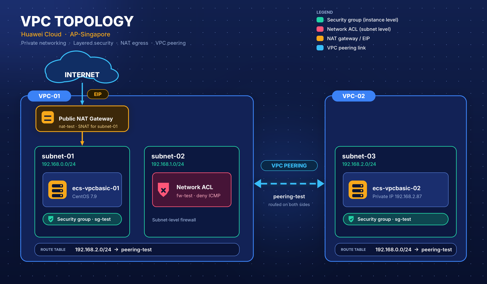

# Huawei Cloud Solutions: Secure Multi-VPC Networking

**Designing, securing and connecting private networks on Huawei Cloud (AP-Singapore), with every change tested before and after.**


Completed as part of the *HCCDP Solution Architecture* programme (Week 2, KooLab 2), October 2026.
Author: **Mubah Mushayyad**

The lab instructions were provided by Huawei KooLab. The implementation, the topology diagram, the testing and the write-up below are my own work, done in a live cloud sandbox.

---

## At a glance

| | |
|---|---|
| **Goal** | Build a private network, protect it in layers, give private servers safe internet access, and connect two isolated networks |
| **Platform** | Huawei Cloud, AP-Singapore region |
| **Services used** | VPC, Subnets, Security Groups, Network ACL, ECS (CentOS 7.9), Elastic IP, Public NAT Gateway (SNAT), VPC Peering, Route Tables |
| **Verified with** | `ping` and `ssh` between servers, before and after each change |

| # | Problem | Solution | Result |
|---|---|---|---|
| [1](#1-segment-the-network) | One flat network is hard to secure | VPC with two non-overlapping subnets | Two subnets, after fixing a CIDR conflict |
| [2](#2-restrict-access-to-individual-servers) | Default web template opens ports the servers don't need | Security group with least-privilege rules | SSH blocked, then restored with an explicit rule |
| [3](#3-add-a-second-firewall-layer-at-the-subnet) | Need protection beyond per-server rules | Network ACL with an ICMP deny rule | ACL associated with subnet-02 |
| [4](#4-give-private-servers-internet-access-without-exposing-them) | Private server needs outbound internet | Public NAT gateway, EIP and SNAT rule | Private server reaches a public domain with no public IP |
| [5](#5-connect-two-isolated-vpcs) | Two VPCs cannot talk to each other | VPC peering with routes on both sides | Failing ping turned into replies |

---

## Architecture



| Resource | Name | Range / detail |
|---|---|---|
| VPC | vpc-01 | Contains subnet-01 and subnet-02 |
| Subnet | subnet-01 | 192.168.0.0/24 (hosts ecs-vpcbasic-01, SNAT source) |
| Subnet | subnet-02 | 192.168.1.0/24 (network ACL `fw-test` associated) |
| VPC | vpc-02 | Contains subnet-03 |
| Subnet | subnet-03 | 192.168.2.0/24 (hosts ecs-vpcbasic-02, 192.168.2.87) |
| Security group | sg-test | Applied to both servers |
| NAT gateway | nat-test | SNAT rule for subnet-01, using an Elastic IP |
| Peering | peering-test | Routes on both sides: 192.168.2.0/24 in vpc-01, 192.168.0.0/24 in vpc-02 |

## Core concepts

| Term | Plain-English meaning |
|---|---|
| VPC | A private, isolated network in the cloud |
| Subnet | A smaller section of a VPC used to organise resources |
| ECS | A virtual server placed inside a subnet |
| Security group | A virtual firewall attached to individual servers |
| Network ACL | A firewall applied to a whole subnet |
| NAT gateway + SNAT | Lets private servers reach the internet without a public IP |
| EIP | A public IP address that can be attached to cloud resources |
| VPC peering | A private link between two VPCs, which needs routes on both sides |

| Traffic | Protocol and port |
|---|---|
| Ping | ICMP |
| SSH | TCP 22 |
| HTTP | TCP 80 |
| HTTPS | TCP 443 |

---

## 1. Segment the network

**Problem:** a single flat network is hard to secure, so I needed a VPC split into separate subnets.

**Solution:** created `vpc-01` (default CIDR) with `subnet-01`, then added `subnet-02`.

**What went wrong:** my first attempt at the second subnet was rejected with the error *"This CIDR block overlaps with another subnet in the current VPC."*

**Fix:** subnet ranges inside one VPC cannot overlap, so I chose a distinct range (192.168.1.0/24).

**Result:** the VPC now shows two subnets.

---

## 2. Restrict access to individual servers

**Problem:** the "general-purpose web server" security group template allows HTTP and HTTPS, which these servers do not need.

**Solution:**
1. Created `sg-test` from the template and deleted the inbound rules for ports 80 and 443 (least privilege).
2. Deployed two CentOS 7.9 servers (`s6.small.1`, pay-per-use, no public IP) in `vpc-01`: `ecs-vpcbasic-01` in subnet-01 and `ecs-vpcbasic-02` in subnet-02, both using `sg-test`.
3. Confirmed that ping and SSH worked between the two servers.
4. Deleted the SSH rule (TCP 22) and the rule allowing traffic from members of `sg-test`.

**Result:** after removing the rules, ping still worked but SSH failed, which shows that each protocol is controlled by its own rule. I then added an explicit TCP 22 allow rule and SSH worked again.

---

## 3. Add a second firewall layer at the subnet

**Problem:** security groups protect individual servers, but I also wanted a control that applies to everything in a subnet.

**Solution:** created a network ACL `fw-test`, added an inbound rule (Deny, ICMP, source 0.0.0.0/0), and associated it with subnet-02, where `ecs-vpcbasic-02` was running at that point.

**Result:** the ACL is attached to subnet-02. The lab's expected outcome is that ping from `ecs-vpcbasic-01` to `ecs-vpcbasic-02` now fails while SSH is unaffected.

| | Security group | Network ACL |
|---|---|---|
| Applies to | Instance (network interface) | Subnet |
| State | Stateful | Stateless |
| Rule types | Allow rules | Allow and deny rules |

---

## 4. Give private servers internet access without exposing them

**Problem:** a server with only a private IP cannot reach the internet, but giving it a public IP would expose it.

**Solution:**
1. Confirmed that `ping www.huawei.com` failed from `ecs-vpcbasic-01`.
2. Bought an Elastic IP (dynamic BGP, billed by traffic, 20 Mbit/s).
3. Created a small public NAT gateway `nat-test` in `vpc-01` / subnet-01.
4. Added an SNAT rule for subnet-01 that translates outbound traffic to the EIP.

**Result:** the same ping to `www.huawei.com` now received replies, while the server still has no public IP of its own.

---

## 5. Connect two isolated VPCs

**Problem:** resources in separate VPCs cannot reach each other by default.

**Solution:**
1. Created `vpc-02` with `subnet-03` (192.168.2.0/24), chosen so it does not overlap `vpc-01`.
2. Moved `ecs-vpcbasic-02` into `vpc-02` / subnet-03 with private IP 192.168.2.87.
3. **Baseline:** pinging it from `ecs-vpcbasic-01` received no replies, which confirms the isolation.
4. Created the peering connection `peering-test` (status: Accepted).
5. Added a route in each VPC's route table pointing the other VPC's subnet at the peering connection.

**What went wrong:** adding a route in `rtb-vpc-01` was rejected with *"An identical route already exists,"* because that table already had the entry it needed. The missing route was on the other side, so I checked the existing entries in each table and added it to `rtb-vpc-02`, where it succeeded.

**Result:** the failing ping started receiving replies once routes existed on both sides. The TTL of 63 is consistent with traffic passing through a routed hop between the two VPCs. The packet-loss figure in the ping summary reflects the earlier isolated period, because the same ping was left running throughout.

If two servers are in the **same** VPC but different subnets, peering is not needed. In that case check routing, security groups and network ACLs instead.

---

## Troubleshooting log

| Symptom | Cause | Fix |
|---|---|---|
| "CIDR block overlaps with another subnet" when creating subnet-02 | Second subnet reused an address range already in the VPC | Chose a distinct, non-overlapping range |
| SSH fails but ping works after editing the security group | The TCP 22 rule had been deleted | Added an explicit TCP 22 allow rule |
| "An identical route already exists" when adding a peering route | The entry already existed in that route table; the missing one was in the other VPC's table | Reviewed existing routes in both tables and added the missing route to `rtb-vpc-02` |
| No ping replies between VPCs after peering was accepted | A peering connection alone does not create routes | Added a route on each side pointing the other VPC's subnet at the peering connection |

## Key takeaways

- **Peering needs routes on both sides.** The connection alone is not enough.
- **Address planning matters up front.** Overlapping CIDRs block subnet creation and would block routing between networks.
- **Defence in depth.** Security groups protect instances; network ACLs protect subnets. They behave differently (stateful vs. stateless) and work best together.
- **Private by default.** NAT lets private servers go out to the internet without being reachable from it.
- **Test before and after.** Capturing a failing state and then a working one makes each change provable.

## Skills demonstrated

VPC and subnet design · CIDR planning · Security groups · Network ACLs · NAT gateway / SNAT · Elastic IP · VPC peering and route tables · Linux server access over SSH · Connectivity testing with ping · Troubleshooting from console error messages

## Repository structure

```
huawei-cloud-solutions/
├── README.md
└── diagrams/
    └── vpc-topology.png
```

## Notes

- Everything ran in a temporary lab sandbox provided by Huawei KooLab, and the resources no longer exist.
- The lab session was re-provisioned partway through, so private IP addresses and resource IDs may differ between steps.
- No credentials or personal account details are included in this repository.
